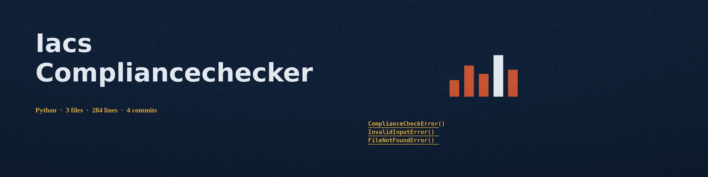

# iacs-ComplianceChecker
Checks a Terraform (HCL) file against compliance rules you supply in a YAML rules file, and reports each resource property that differs from the value its rule requires. There is no predefined rule set in this repo: no CIS benchmark or PCI DSS rules ship with it, and the report holds the violations only, with no remediation recommendations. A property a rule names but a resource does not set counts as a violation, with the actual value recorded as absent. A rule set naming a resource type that the file does not contain is logged as not checked. An IaC file that parses to an empty structure, or one holding no resources, exits 1 instead of passing. The exit code is 1 when violations are found and 0 when every checked property matches. Dependencies: `deepdiff`, `python-hcl2`, and `PyYAML`, listed in requirements.txt.

A rules file maps a resource type to the property values it requires:

```yaml
aws_s3_bucket:
  acl: "private"
```

## Install
`git clone https://github.com/ShadowStrikeHQ/iacs-compliancechecker`

## Usage
`python3 main.py -i example.tf -r rules.yaml -o report.txt`

## Parameters
- `-h`: Show help message and exit
- `-i`: Path to the Terraform (HCL) IaC configuration file
- `-r`: Path to the compliance rules file (YAML)
- `-o`: Path to the output file for the report (optional). It may not be the IaC file or the rules file; the run refuses at exit 1 rather than overwrite an input.
- `-f`: Output format, yaml or text (default: text). The yaml report holds plain data and loads with yaml.safe_load.

## License
Copyright (c) ShadowStrikeHQ
